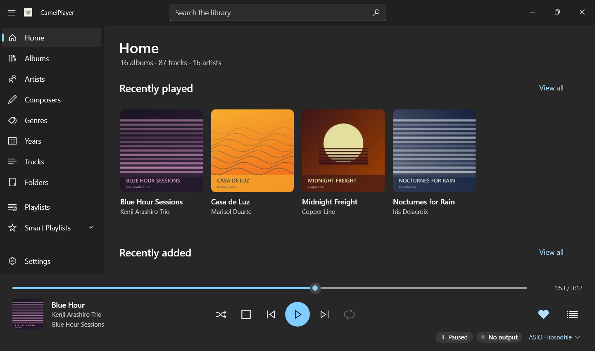
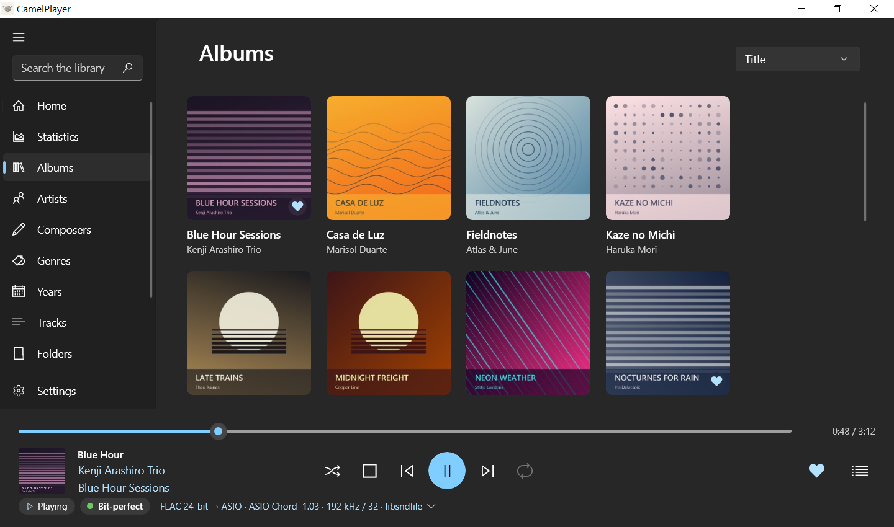
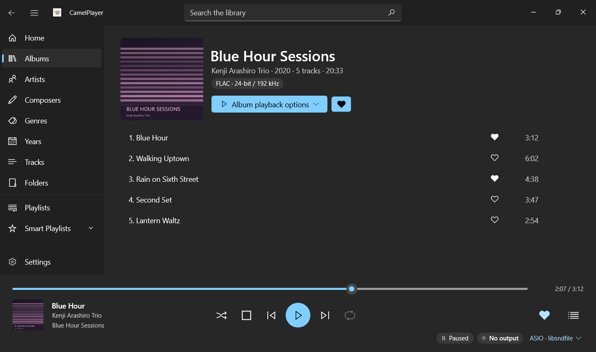
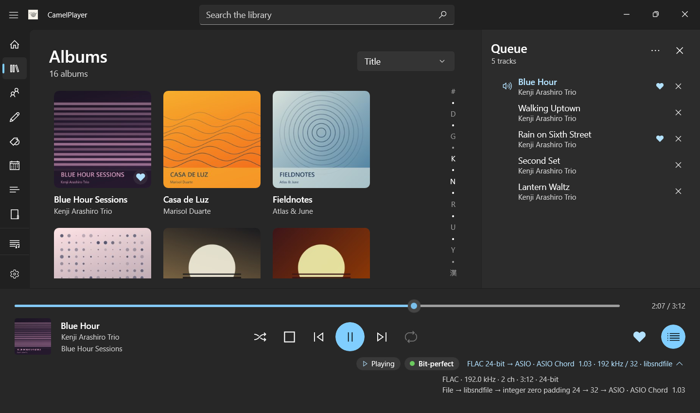
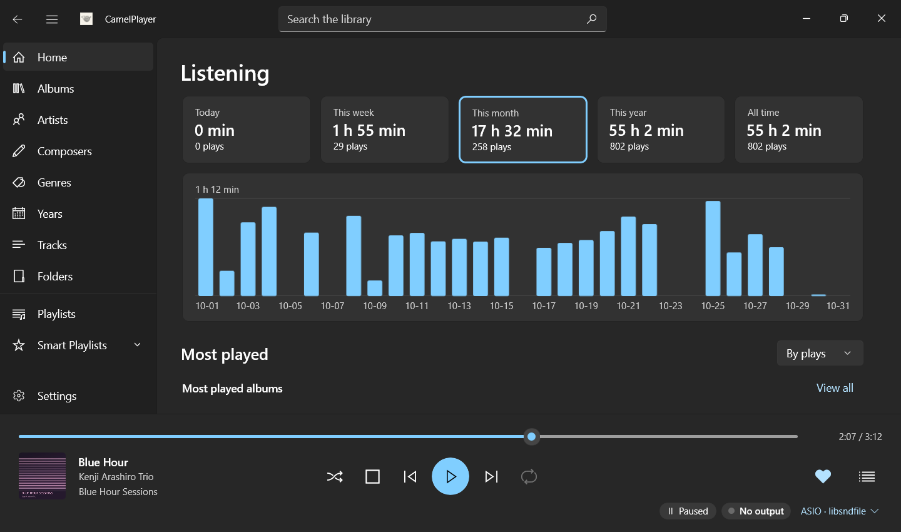
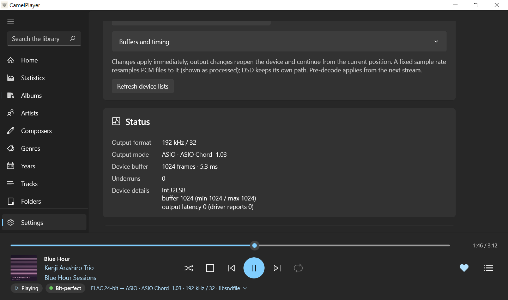

# CamelPlayer


CamelPlayer is a Windows music player for listening through a DAC. It plays FLAC, ALAC, WAV, AIFF, DSD, AAC and MP3 bit-perfect over WASAPI exclusive, ASIO or Kernel Streaming, shows exactly what reaches the device, and keeps a large library on local drives or a NAS quick to browse.

It is built with C++20, WinUI 3 and Rust, and is a separate project from the earlier macOS CamelPlayer, a controller for streaming from MinimServer to a network player, with which it shares only its name.

**Download:** a portable zip from [GitHub Releases](https://github.com/pcjustin/CamelPlayer/releases), no installer needed. **Read:** the [user guide](guide/UserGuide.md) ([繁體中文](guide/UserGuide.zh-TW.md)), also inside the zip, and [what changed](CHANGELOG.md).

## Screenshots

The screenshots show a demo library with made-up albums and covers.

|  |  |
|:---:|:---:|
| Home: recently played and recently added albums | The album wall with its jump bar |
|  |  |
| Album details with format badges and favorites | The queue and the signal path of bit-perfect ASIO playback |
|  |  |
| Listening: this month's time, plays and most played | Settings: the output status during playback |

## Features

### Sound

- **Bit-perfect playback** of 16- and 24-bit lossless files through WASAPI exclusive, ASIO or Kernel Streaming, and WASAPI shared mode when other programs must play too.
- **DSD** from DSF and DSDIFF files as native DSD on ASIO or as DoP on every backend, up to DSD512 where the device takes it.
- **Nothing is converted without your permission.** When a device does not take a file as it is, CamelPlayer skips it and tells you, unless you allow resampling, downmixing to stereo, dither to a lower bit depth or DSD to PCM.
- **The signal path on screen:** badges show bit-perfect, processed, lossy source or raw DSD playback, and the format line opens every step from file to device.
- **Gapless playback** between tracks of the same format.
- **Output settings for each backend:** a fixed sample rate, pre-decode amount, silence after a format change, device release after a pause, buffers, MMCSS priority, and ASIO and Kernel Streaming options.

### Library

- **Local folders and NAS shares**, several added at once, scanned in the background and followed as files change. Offline folders keep their tracks, and moved files keep their history, favorites and playlist entries.
- **Browsing:** Home, an album wall sorted by title, artist, year or date added, artists, composers, genres, years, a sortable track list, album details by disc with format badges, and folder pages, all with covers. Album covers are sized so that every row fills the window.
- **A jump bar** beside the album, artist, composer and genre lists goes straight to #, A–Z, kana or Han.
- **Artist and composer pages:** their ten most played tracks, then their own albums and the albums they appear on, each with View all, so a singer's songs on someone else's album are one click away.
- **Every name in a credit counts:** "Aimer with chelly" or "A feat. B" lists each artist on its own, and each name on an album page and in the player bar opens that artist.
- **Search** from the title bar (Ctrl+F) with suggestions as you type, including Chinese and Japanese.

### Queue, playlists and favorites

- **A queue** with play next, add to the end, reordering, shuffle, repeat and history, restored at the next start. When it ends, autoplay keeps random library tracks playing.
- **Playlists** made from any selection, with M3U8 import and export.
- **Favorite tracks and albums**, and smart lists: recently added, most played, last played, favorites and never played.

### Listening

- **Home** shows this month's listening time, plays and most played album, and opens the **Listening** page: totals for today, this week, this month, this year and all time, a listening-time chart, the most played albums, artists and tracks, and the play history.

### Windows

- **Media keys**, the volume flyout and the lock screen show and control playback, and system-wide hotkeys can be changed.
- **The notification area** keeps CamelPlayer running after its window closes, and only one copy runs at a time.
- **Light and dark themes** or the Windows setting, and an English and Traditional Chinese interface.

### Reliability

- **Automatic updates** from GitHub Releases, checked and confirmed before installing, and undone if they fail.
- **An installation check** on the first start of each version repairs damaged or missing program files.
- **Damaged data recovery:** settings come back from the previous start's copy and the library from its daily backup.
- **A diagnostic bundle** in Settings › About collects what a problem report needs.

## Getting started

1. Download `CamelPlayer-<version>-win-x64.zip` from [GitHub Releases](https://github.com/pcjustin/CamelPlayer/releases), and if you like, check it against `CamelPlayer-<version>-SHA256SUMS.txt`.
2. Extract the whole zip to a folder you can write to and run `CamelPlayer.exe`. CamelPlayer is not code-signed, so Windows may ask you to confirm the first start.
3. The first-run guide sets the look, your music folders and the output.

CamelPlayer needs 64-bit Windows 10 version 1809 or later, or Windows 11. Settings, the library and logs are kept in `%LOCALAPPDATA%\CamelPlayer`. To report a problem, open a GitHub issue and attach the diagnostic bundle from Settings › About.

## Formats and outputs

| Format | Decoders (default first) | Notes |
| --- | --- | --- |
| FLAC | libsndfile, FFmpeg, Symphonia, dr_flac | Complete decodes verify the STREAMINFO MD5. |
| WAV, AIFF | libsndfile, FFmpeg, Symphonia, dr_wav | |
| ALAC | Symphonia, FFmpeg | |
| AAC-LC | Symphonia, FFmpeg | Decoded to 24-bit PCM (16-bit as an option) with encoder delay and padding trimmed. |
| MP3 | mpg123, FFmpeg, Symphonia, dr_mp3 | As AAC. A file that declares no length is listed with an estimate until it first plays. |
| DSF, DSDIFF | DSD Nexus | Raw DSD; DST-compressed DSDIFF is not supported. |

Files are recognized by their content, not their extension. Mono files are copied to both channels bit for bit, and only stereo output is produced; a surround file plays only when downmixing is allowed (ITU-R BS.775).

| Backend | Bit-perfect | DSD | Notes |
| --- | --- | --- | --- |
| WASAPI exclusive (default) | Yes | DoP | Can follow the Windows default device; a device you chose pauses when it disappears. |
| WASAPI shared | No | To PCM only | Always goes through the Windows mixer, so it is shown as processed. |
| ASIO | Yes | Native or DoP | The ASIO callback thread joins MMCSS Pro Audio, and late callbacks are reported. |
| Kernel Streaming | Yes | DoP | Windows defines no Kernel Streaming DSD format. |

DoP needs a PCM rate of the DSD rate / 16, so DSD512 over DoP plays only where the device offers 1411.2 kHz. DSD becomes PCM only when you set a backend's DSD output to PCM or allow it after native DSD and DoP were refused: it is decimated to 352.8 kHz with a multistage FIR filter (100% modulation = 0 dBFS), resampled with libsoxr to 88.2, 176.4 or 352.8 kHz and quantized once. Allowed PCM conversions use libsoxr for resampling and TPDF dither for a lower bit depth.

## Keyboard and mouse

| Keys | While CamelPlayer is in front |
| --- | --- |
| Space | Play or pause |
| Ctrl+→ / Ctrl+← | Next or previous track |
| Ctrl+Shift+→ / Ctrl+Shift+← | Forward or back 10 seconds |
| Alt+← or the mouse back button | Back, like the title bar's Back button |
| Ctrl+F | Search the library |
| Delete | Remove the selected queue or playlist entries |
| Ctrl-click, Shift-click | Select several rows for their right-click menu |

The system-wide hotkeys work in every program: Alt+Home plays or pauses and Alt+Page Up / Alt+Page Down go to the previous or next track, changeable in Settings › Hotkeys.

## Building from source

Requirements:

- Windows x64; the application targets Windows 10 version 1809 or later.
- Visual Studio 2026 with the Desktop development with C++ workload and Windows SDK 10.0.26100.0. The C++ WinUI app development tools component is not required.
- Rust stable with the `x86_64-pc-windows-msvc` target.
- Internet access for the first vcpkg, NuGet and Cargo restore, and at least 25 GB of free disk space. Building FFmpeg the first time takes about an hour; later builds use caches.

Run from the repository root:

```powershell
.\build.cmd                          # Release build and binary package
.\build.cmd -NoPackage               # Release build without the package
.\build.cmd -Configuration Debug     # Debug build (never packaged)
.\build.cmd -Test                    # Build and run ordinary tests
```

The executables are written to `build/<Configuration>/App/CamelPlayer.exe`, `build/<Configuration>/camelcli/camelcli.exe` and `build/<Configuration>/tests/tests.exe`. A Release build packages `dist/CamelPlayer-<version>-win-x64.zip` with the third-party source and symbol archives and `CamelPlayer-<version>-SHA256SUMS.txt` beside it.

The version comes from the `VERSION` file; the build puts it in the executable's file properties, Settings › About and `camelcli --version`. Change it before tagging a release on GitHub (tag `v` followed by the version).

Each build also writes `build/compile_commands.json`, so clangd (for example in VS Code) applies the repository's `.clang-tidy` checks and `.clang-format` style to the C++ in `src/`. Diagnostics are fixed in the code or the check configuration, never suppressed with `NOLINT`. Rust code is kept clean with `cargo fmt` and `cargo clippy -- -D warnings`.

## Testing

`.\build.cmd -Test` runs the ordinary C++ tests; `cargo test --workspace` in `rust/` runs the Rust Engine tests. On 2026-10-30 a full Release run passed all 638 enabled C++ tests, including the 100k-track search latency target, and all 47 Rust tests.

The 112 disabled tests play audio on named devices or scan a NAS, and need local files under `testdata/` that are not distributed. Lower the volume, then run the hardware tests explicitly after building:

```powershell
.\build\Release\tests\tests.exe --gtest_also_run_disabled_tests --gtest_filter="*Hardware*"
```

NAS tests are also opt-in: set `CAMEL_NAS_ROOT` to an authorized share or album and select `LibraryNas.DISABLED_ReadOnlyFullAndIncrementalScan`. `LibraryNas.DISABLED_IsolatedChangesOverflowAndReconnection` and `LibraryNas.DISABLED_UniqueFingerprintsPreserveMoveHistory` create and remove their own temporary folders on that share, so run them only with permission to create files there. Their databases and reports stay under `build/testtmp/nas-library`.

[VALIDATION.md](VALIDATION.md) records the hardware, NAS and performance runs, and the limits they found.

## Command-line companion

`camelcli` is a development tool and is not included in the release zip.

```text
camelcli list-devices
camelcli play <file.flac> --backend ks --device 0 --decoder drflac
camelcli decode <file.flac>
camelcli capture <file.flac> out.raw
camelcli gen-test-audio [directory]
camelcli bench-decoders <directory> --runs 3   # every recognized format; pure decode, separate FLAC MD5, seek checks
```

`decode` checks decoder output against the STREAMINFO MD5, and `capture` compares the engine's output with an independent libFLAC decode. The generated test audio covers 16- and 24-bit FLAC at rates up to 768 kHz, plus damaged, truncated and missing-MD5 files.

## How it works

CamelPlayer runs as one process with these parts:

- **The control point** (`src/ControlPoint`), the WinUI 3 application, sends versioned commands to the Server and shows its snapshots and events; command IDs and revisions keep stale updates from showing. Every list is virtualized over pages read off the UI thread, and each listing's order is built once per library revision, so a random page of 100k tracks takes about 3 ms and of 1,000 albums about 42 ms (p95, Release).
- **The Server** (`src/Server`) owns settings, device enumeration, the library and playback control.
- **The Engine** (the Rust crate `rust/audio_engine`, hosted from `src/Engine`) owns every playback session. It asks the chosen C++ decoder adapter for frames through a versioned callback ABI, enforces supported input, track ranges and seeking, pre-decodes into a ring buffer, converts to the device format (repacking, and resampling, downmixing, dither or DSD to PCM only when allowed), packs native DSD or DoP, queues the next track for gapless playback and renders to the OutputBridge. For FLAC it reports whether the STREAMINFO frame count and MD5 were verified; the MD5 counts as verified only after a complete decode.
- **The OutputBridge** (`src/OutputBridge`) holds the WASAPI, ASIO and Kernel Streaming backends. ASIO uses an independent host implementation of the driver interface, so no Steinberg SDK is needed (ASIO is a trademark of Steinberg Media Technologies GmbH).
- Shared types and utilities live in `src/Common`, the CLI in `src/Tools/camelcli`, the updater in `src/Updater` and the Symphonia adapter in `rust/symphonia_ffi`. Tests are grouped into `tests/server_tests`, `tests/bridge_tests` and `tests/engine_tests`.

**The library** normalizes overlapping folders and aliases, skips reparse points to avoid cycles, and indexes supported audio with image and LRC sidecars into SQLite. A CUE sheet is not split: as in Roon, its file is one track. TagLib reads tags, including several artists, composers and genres, while FLAC STREAMINFO and Vorbis comments are read without a decoder. Artist and composer tags are kept as written, and the names they credit are derived from all of them together: `;` `、`, feat., ft., featuring, with and a bracket opening with one of those words always divide names, while `&` `,` `/` `:` `×` and the words x, and and vs divide them where at least one part also stands alone somewhere in the library, though never before a name opening with "The" after & or and, or before an instrument such as cello, so "22/7", "Bob Marley & The Wailers" and "Yo-Yo Ma, cello" stay whole. Case tells names apart, full- and half-width forms do not, and text in other brackets stays with its name. Names are derived again after each complete scan and whenever the rules change. Scans publish batches of 500 files, reread a file only when it changes, and group albums as each batch is written, so albums appear during the first scan; several folders scan at the same time. Folder monitoring coalesces changes for 2 seconds and rescans only the folders named, rescans fully after lost notifications, polls local folders every 30 minutes and network shares every 6 hours, and checks that each folder is reachable every 60 seconds. An incomplete or offline scan keeps the tracks it did not see; a complete scan marks missing files unavailable without forgetting them.

**Moved files** keep their identity, statistics, favorites, playlist entries and queue entries. Local NTFS and ReFS moves are matched by volume GUID, 128-bit file ID and creation time; moves on a NAS or across volumes need a unique fingerprint recorded before the file disappeared, a SHA-256 over the file size and its first and last 64 KiB, so fingerprinting reads at most 128 KiB per file. Each new or changed file is fingerprinted right after its tags are read, while its start is still cached, and fingerprinting waits while music plays from the same storage. Copies stay separate, and missing or ambiguous fingerprints keep separate identities. Move decisions wait for a complete scan.

**Covers** come from the first track's own folder (including CD subfolders), then its embedded front cover, then the parent of a disc folder; the player bar prefers the playing track's embedded cover. WIC makes thumbnails up to 256 pixels in the background after a scan, with libwebp where Windows cannot decode WebP, so browsing never reads covers from the music storage. They stay within a 512 MiB disk cache and a 32 MiB in-memory cache, and source images are limited to 32 MiB, 16,384 pixels a side and 40 million pixels.

**Search and sorting** normalize Chinese and Japanese text, with OpenCC dictionaries beside each executable, and sort with NLS-versioned Windows collation. A sort tag garbled into question marks is ignored in favor of the name.

## Dependencies and licensing

FFmpeg, dr_flac and libsndfile are restored through the pinned vcpkg manifest. Symphonia and the Rust Engine come from Cargo with one committed workspace lockfile and are linked into one static library. The repository includes third-party license and notice snapshots and a [dependency inventory](third_party/dependencies.json); [THIRD-PARTY-NOTICES.md](THIRD-PARTY-NOTICES.md) lists what must accompany a release. To refresh the notice snapshots after restoring dependencies:

```powershell
powershell -NoProfile -ExecutionPolicy Bypass -File msbuild/collect-licenses.ps1
```

Local planning documents, development probes, private test music, downloaded packages, build outputs and caches are kept out of Git, so GitHub's source archive of a release tag holds only the committed files, not the dependencies the package managers download.

CamelPlayer is licensed under the [Mozilla Public License 2.0](LICENSE). Versions published before the change to MPL-2.0 remain available under the GNU GPL version 3. Third-party components keep their own licenses; the root license does not relicense Microsoft binaries or replace LGPL, MPL, MIT, BSD or other notices. MPL-2.0 allows CamelPlayer to be combined with the Microsoft-licensed Windows App SDK and WinUI binaries, and no Steinberg ASIO SDK code remains, so no third-party GPL code blocks a binary release; a review of the complete notice set is still due before the first public release.

A binary release must come with access to the exact corresponding source, dependency changes and build information, and all required notices. Packaging also builds `CamelPlayer-<version>-win-x64-third-party-source.zip` with the exact sources of the LGPL and MPL libraries linked into the program, and [THIRD-PARTY-NOTICES.md](THIRD-PARTY-NOTICES.md) explains how to rebuild against a modified one. `msbuild/check-licenses.ps1`, run by the build and packaging scripts, fails on a file without the MPL-2.0 header or a dependency missing from the notices. Packaging prepares the files; it does not establish permission to redistribute or publish a release.
